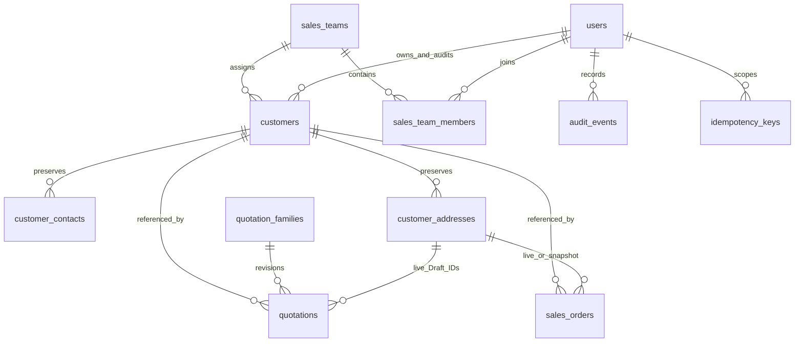

# Customers backend

Implemented in the existing JavaScript/Express/Sequelize application. This module manages garment buyers using the same `customers`, `customer_contacts` and `customer_addresses` used by Quotations and Sales Orders. There are exactly six new routes; no child CRUD, customer DELETE, login or finance balance APIs are added. The Next.js/React frontend implements list/create/profile/edit, lifecycle dialogs and document tabs; see [frontend journeys](../../frontend/docs/customers-journeys.md).

| Method | Path under `/api/v1` | Result |
| --- | --- | --- |
| GET | `/customers` | Scoped, filtered/paginated summaries |
| GET | `/customers/:id` | Profile, stable child IDs, archive metadata and bounded commercial summary |
| POST | `/customers` | Atomic create; required `Idempotency-Key` |
| PATCH | `/customers/:id` | Versioned aggregate change set |
| POST | `/customers/:id/archive` | Version/reason, checks all commercial blockers |
| POST | `/customers/:id/reactivate` | Version/reason, validates complete current master |

Contracts: [OpenAPI](customers.openapi.yaml), [readable MySQL DDL](customers.schema.sql), [screen/API journeys](customers-ui-integration.md), [verification guide](customers-verification.md), [Postman](postman/customers.postman_collection.json).

## Run with the existing MySQL

From the repository root:

```sh
cd backend
npm ci
# Existing MySQL volume and backend/.env are reused.
docker compose up -d mysql
npm run migrate
npm run seed
NODE_ENV=development npm run seed:customers
```

For an existing database containing legacy customers without creator/last-editor metadata, `npm run migrate` first stops with an explanation. Review the reported customer IDs and repair any missing payment terms, contacts/default addresses, duplicate flags or invalid configured country/currency yourself; no row is deleted and no first primary/default is chosen. Then explicitly identify an existing active Admin to attribute the **schema-adoption operation**:

```sh
CUSTOMER_MIGRATION_ACTOR_ID=10000000-0000-4000-8000-000000000003 npm run migrate
```

That UUID is the repository's seeded demo Admin; use the correct existing Admin for another installation. `created_by`/`updated_by` for unknown legacy rows record adoption responsibility, not proven historical creation. `CustomerMigrated` audit metadata records `historicalCreatorUnknown` and `historicalChildTimestampsUnknown`. Newly introduced child timestamps are the migration time when the original timestamps are unavailable. Existing creator/archive metadata is retained. Archived legacy rows without reasons additionally require a reviewed `CUSTOMER_LEGACY_ARCHIVE_REASON`; there is no inferred business reason. MySQL DDL auto-commits: the additive migration checks column/index/constraint presence so it can resume after failure. It never rewrites quotation/order snapshots.

Container-only migration/seed alternatives (after building the updated backend image):

```sh
docker compose run --rm backend npm run migrate
# For reviewed legacy attribution only:
docker compose run --rm -e CUSTOMER_MIGRATION_ACTOR_ID=10000000-0000-4000-8000-000000000003 backend npm run migrate
docker compose run --rm -e NODE_ENV=development backend npm run seed:customers
```

A new empty database needs no attribution variable: migrate before seeding. Never reset volumes or run the SQL reference file over an existing database. Rollback refuses while customer records exist; a reviewed forward migration is the safe recovery path.

Start the existing Sales API and an additional localhost Admin API:

```sh
# Terminal 1, backend/.env: NODE_ENV=development, DEV_AUTH_ENABLED=true, DEV_ACTOR=sales
docker compose up -d --build backend
# Terminal 2, from backend/
HOST=127.0.0.1 PORT=4102 NODE_ENV=development DEV_AUTH_ENABLED=true DEV_ACTOR=admin npm start
```

Base URL is `http://127.0.0.1:4102/api/v1`; list is `/customers`. `/api/v1` itself has no route. Sales/manager/viewer read permitted profiles; their Customers writes return403. Do not send actor/role headers. Development auth selects one server-side principal and is prohibited in production. Production must supply a trusted `req.user` adapter before routers; no authentication implementation is included.

The implementation was refreshed locally using the existing image's installed dependencies after confirming its `package-lock.json` SHA256 matched the repository. No dependencies changed. Standard rebuild remains `docker compose up -d --build backend`; no fresh dependency installation is claimed by that cached update.

## Data and permissions

`customers.is_active` remains canonical, mapped to `Active`/`Archived`. Active rows have null archive metadata; Archived rows require actor/time/reason. Codes are immutable and unique for all time, assigned as `CUS-` plus at least six digits using a nonyearly, transaction-locked `CUSTOMER` sequence. Existing `OCEAN` code is retained; the new seed is a separate legal entity example with its own code. The migration reconciles any preexisting numeric `CUS-*` codes under its global migration lock. Runtime numbering never uses COUNT or MAX.

Admin can read/write all customers. Other roles read only `req.user.salesTeamIds`. A trusted upstream principal may explicitly carry `capabilities: ['customers:write']` for master-data writes within its existing team scope; ownership changes additionally require `customers:assign`. These capabilities are never read from request headers/body and do not grant additional teams. Team membership alone never grants master-data writes. The selected owner must be an active user and active member of an active selected team, independent of their role. On replay, current actor activation, write permission and current resource scope are checked before returning the saved result.

The list excludes contacts/addresses/internal notes. Authorized internal detail includes notes; these never enter quotation/order customer snapshots or buyer PDFs. Document blocker examples and document counts are filtered using document team scope independently of customer assignment. `blockerCount` is global to prevent unsafe archive; `visibleBlockerCount`, `openQuotationCount`, `draftOrderCount`, and `activeOrderCount` are actor-visible. `countsScope` and `blockerCountScope` explain that difference; `restrictedBlockers` indicates hidden dependencies without revealing IDs/numbers/teams. Examples are capped at20. `canArchive` is blocker eligibility; `allowedActions` additionally considers write permission.

## Aggregate PATCH and validation

POST generates parent/child IDs; client IDs are rejected. PATCH always has `version`; fields and existing children omitted from the request survive. `contacts:[]` and `addresses:[]` do nothing. Existing child updates merge only supplied fields, including booleans; new children require their create fields. Duplicate/cross-customer IDs return422 `INVALID_CHILD_REFERENCE` without foreign data. `addressType` is canonical and immutable; `primary` maps to `is_primary`, `isDefault` to `is_default`. No `type` alias is accepted.

Every save validates the full final aggregate: exactly one active primary contact; an active default billing and shipping address; inactive rows cannot occupy flags; every active contact has email or phone. Limits are50 active and500 stored per child type,100 submitted changes per type,1MB JSON. MySQL generated nullable slots independently enforce at most one active primary/default. Services enforce the required exactly-one rules under parent lock. A valid swap clears all affected occupied slots before applying updates/inserts. Any later failure restores original slots, rows, parent version and audit.

Only actual changes increment the parent version, once; no child versions exist. A no-op creates no audit/version change, but stale versions still409. Ownership edits that actually change team or owner require both IDs, reason, assignment permission and active membership. Existing document ownership remains independent. Archived profiles may be repaired without reactivating; inactive old ownership can remain temporarily while other archived fields are repaired. Changed ownership and all reactivations must pass active assignment checks.

Country is trimmed/uppercased against `COMPANY_COUNTRIES`; default currency is USD/LKR/GBP/EUR and does not perform FX. Email is trimmed, domain lowercased, local-part case preserved; it is descriptive and nonunique. Phones permit international punctuation with7–18 digits; neither channel is verified. Blank optional strings become null. Websites allow absolute HTTP/HTTPS but are never fetched. Registration numbers are descriptive. Search escapes literal `\`, `%`, `_` using parameterized LIKE. Substring `%q%` matching is acceptable for this POC; B-tree indexes do not accelerate arbitrary substring matching. Sorting is name/code/createdAt with ID tie-breaker; scope precedes pagination/count.

Audit is append-only and transactional. `CustomerCreated`, `CustomerUpdated`, `OwnershipChanged`, `CustomerArchived`, `CustomerReactivated` are recorded. `CustomerUpdated.metadata.children` groups added/updated/deactivated child IDs and changed field names instead of duplicating each contact/address payload into separate events. Ownership metadata holds old/new assignment IDs and the required reason. Archive/reactivation reasons persist in audit when current archive metadata is cleared.

Create idempotency hashes the method, canonical path `/api/v1/customers`, and validated/normalized body with recursively sorted object keys (array order remains significant). The actor/operation/key scope is unique. Same key/body returns the saved201 result; different body conflicts; a different key intentionally creates a distinct buyer even with the same name/email. Keys are retained (no automatic expiry/cleanup in this POC), and codes are never reused. A timeout retry must retain its key/body.

## Commercial compatibility and locking

Archive blocks every nondeleted quotation revision in Draft/PendingApproval/Approved/Issued/Accepted and every nondeleted Draft order. Deleted/resolved quotations and Confirmed/InProgress/PartiallyDelivered/Delivered/Closed orders do not block. A stale date-expired Issued offer still blocks; `validityEnded:true` directs the UI to resolve expiry through Quotations. Customer archive never secretly expires another document.

Disabling an address checks both billing/shipping live IDs on nondeleted Draft quotations and Draft orders;409 `ADDRESS_IN_USE` gives authorized examples. Converted Draft orders with null live address IDs and only frozen snapshots do not block that particular address. Current conversion normally copies IDs, so those uses do block. Frozen document use never blocks address deactivation; the old row remains. No document stores a live contact ID here, so contact deactivation requires replacing the primary but has no additional document-reference blocker.

Address text/default changes affect future selections. They do not move an existing order to another warehouse or edit document snapshots. A Draft recaptures allowed current values through its own save/submission/confirmation flow. Confirmed fulfilment and historical PDF reads continue after archive.

Global locking protocol:

1. Customer create: actor check → idempotency row UPDATE → team/user/membership SHARE → sequence row UPDATE → insert aggregate/audit/replay result, one transaction.
2. Customer PATCH/archive/reactivate: parent customer UPDATE → child UPDATE locks as needed → team/user/membership SHARE as needed. Blocker queries are plain committed reads; never acquire family/quotation/order locks while holding the customer UPDATE lock.
3. Document mutations retain their existing family/quotation/order locking order, then hold customer SHARE while checking buyer activity and child/address references through commit. Quotation create/save/submit/approve/issue/revision/accept/convert and order create/save/confirm participate. Confirmed shipping amendments hold customer SHARE with `requireActive:false`, allowing existing operations after archive while serializing address changes. Fulfilment remains independent of customer activity.
4. Customer write transactions use READ COMMITTED. After waiting for parent UPDATE, blockers observe the now-committed document writer. Conversely a writer waiting for customer SHARE rechecks activity/addresses after archive/deactivation commits. Customer queries do not establish stale repeatable-read snapshots before the wait.
5. Deadlock/lock-timeout retries are bounded to two retries around the entire rollback-safe transaction. Database constraints provide the final uniqueness/FK safety net. No network side effects occur inside these customer transactions.

This ordering avoids archive taking document locks in reverse order. Idempotent historical conversion replay can still retrieve an existing authorized result; it does not create new commercial work after archive. Direct DB writes bypass service rules and are not a supported application integration.

## Compact ER diagram



`customer_code_sequences` allocates codes independently of document numbering. Audit entity IDs are polymorphic; no misleading customer-only FK is added to the shared audit table.

## Regenerate API artifacts

From `backend/` with development dependencies installed:

```sh
npm run docs:customers
node scripts/generate-customers-postman.js
node scripts/generate-customers-ddl.js
```

The DDL exporter reads table definitions only from the configured migrated MySQL; it exports no records or credentials.
