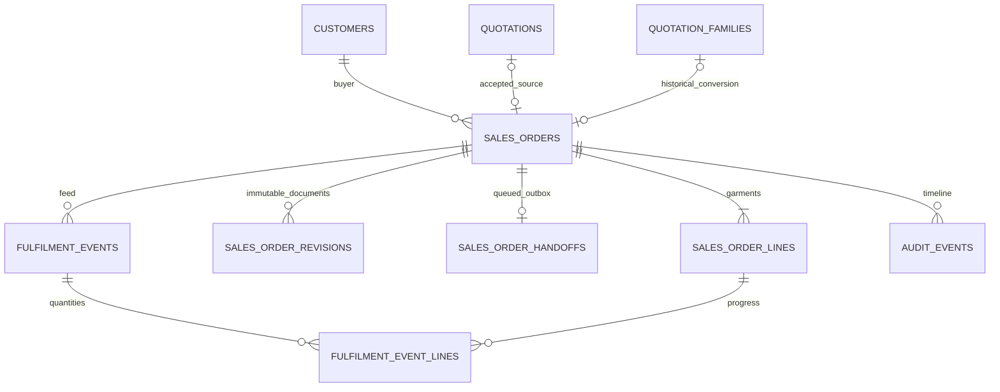

# Sales Orders backend

This module adds exactly **15 operations** at `/api/v1/sales-orders`. It extends the quotation-created `sales_orders` and `sales_order_lines`; it does not create a competing order store. The quotation module retains `POST /api/v1/quotations/:id/convert` and its existing response shape. The frontend now includes Sales Orders screens; screen integration is documented below and in the frontend testing guide. The existing frontend uses Next.js App Router, so the pasted Vite assumption does not require a framework migration.

## Start and database setup

Use the existing Node 22+ installation and MySQL 8.4 Docker service. Preserve `backend/.env`, existing tables and the `mysql_data` volume. No database reset is needed.

```sh
cd backend
npm ci
docker compose up -d --wait mysql
npm run migrate
npm run seed
# Optional: create/reuse a direct Draft and an accepted-quote converted Draft.
NODE_ENV=development npm run seed:orders
DEV_AUTH_ENABLED=true DEV_ACTOR=sales npm run dev
```

For Docker API deployment after migrations: `docker compose up --build -d backend`. The existing Compose service forwards the current `.env` settings. Keep `NODE_ENV=development` for fixed dev actors; production startup refuses `DEV_AUTH_ENABLED=true`. Production authentication remains the responsibility of trusted upstream middleware supplying `{id, role, salesTeamIds}`. These APIs accept no actor headers, role fields or login requests.

A second local backend against the same database gives the manager identity:

```sh
PORT=4101 DEV_AUTH_ENABLED=true DEV_ACTOR=manager npm start
```

- Host Node process / SQL client: DB host `127.0.0.1`, port `MYSQL_PORT` (normally 3306).
- Backend container: DB host `mysql`, port `3306`; Compose supplies `DB_*` from the existing `MYSQL_*` configuration.
- Explicit `DB_HOST`, `DB_PORT`, `DB_NAME`, `DB_USER`, `DB_PASSWORD` override the existing environment fallbacks.
- `COMPANY_NAME` and `COMPANY_TIMEZONE` configure seller name and business dates. Default timezone is Asia/Colombo. Seller identity is frozen in each document snapshot.
- `COMPANY_COUNTRIES` is the POC master buyer/address country allowlist (default US,LK,GB,DE,FR,IN,BD,CN,PK,VN,AU,CA); expand it for the countries served by your business.
- No production adapter is configured. Handoff dispatch remains disabled in code unless an application explicitly supplies an adapter and `enabled: true`. There is no environment switch that silently acknowledges or dispatches work.

Seed dates are relative to the current company business date. Example PO `OA-1045` and fixed November dates in the specification are examples, not hard-coded deadlines. `seed:orders` uses a persistent create key and a recognizable demo quotation; rerunning reuses these fixtures rather than overwriting existing commercial records. Run seed commands serially. It is not a production data importer.

## Migration and data preservation

Migration `004-sales-orders` is additive and restartable after partially completed MySQL DDL. It checks unsupported legacy statuses/versions and duplicate normalized active POs before adding constraints. Conflicting legacy data causes a failure identifying the issue; it is never silently deleted. Existing converted snapshots, line IDs, order IDs/numbers and source links survive.

Existing `notes` remains in the database. Its content is copied to **internal_notes** when backfilling orders; it is never copied to public_notes. New quotation conversions also explicitly copy quotation notes as internal. Converted order dates use the source quotation date (including new conversions), preserving late conversion of accepted quotations whose requested delivery is already past; confirmation then requires updating delivery to a valid future/current date. Existing converted order backfills use source quotation dates where available; otherwise the original creation timestamp is interpreted in the configured company timezone. Address IDs come from the source quotation while frozen address JSON is retained.

A preexisting non-Draft/non-Cancelled record with document revision 0 receives a revision-1 snapshot from its existing frozen content. If that content is missing, migration stops for human reconciliation. It does not create a historical queued handoff, confirmation actor or confirmation timestamp. `sales_order_revisions.created_by` is deliberately nullable **only to represent unknown legacy provenance**; newly created revisions always have the authenticated manager ID. The backfill reason identifies migration-time recording rather than claiming the migration time was the historical confirmation time.

Sequelize append-only hooks protect revisions, fulfilment events/lines and shared audit events. No application operation updates or deletes immutable history. Database triggers are not required: the existing application MySQL user cannot create triggers with binary logging enabled without elevated privileges. Production DB roles should give these history tables only the permissions needed by the application; direct DBA writes are outside the API guarantee. No global MySQL security setting is changed by this module.

`migrate:down` refuses rollback when commercial order/history data exists. On an empty schema it removes the extension. MySQL DDL commits independently; keep backups and use forward migrations for real commercial data. The [readable reference DDL](sales-orders.schema.sql) reflects an actual migrated test database; it is **not** a script to recreate existing tables.

## Normalized buyer PO uniqueness

`active_po_key` is a generated STORED column: `UPPER(TRIM(buyer_po_number))` when the order is nondeleted, noncancelled and PO is nonblank; otherwise NULL. Its explicit collation is `utf8mb4_0900_bin`. `UNIQUE(customer_id, active_po_key)` is the race-safe authority. API mandatory text is trimmed before storage; DB uppercasing defines key identity, including Unicode handling. This avoids a separate JavaScript case-folding implementation drifting from MySQL. A unique conflict maps to **409 DUPLICATE_BUYER_PO**. Cancelling or deleting releases the active PO key while preserving history.

## Lifecycle and permissions

```text
Draft -> Confirmed -> InProgress -> PartiallyDelivered -> Delivered -> Closed
            |               integrations may skip intermediate states
            +-> Cancelled   (only before handoff claim or fulfilment activity)
Draft ------+-> Cancelled
```

Hold is `isOnHold`, never a status. It is supported only for a Confirmed order with a Queued, unclaimed handoff and no fulfilment events. Resume releases that local dispatch restriction; it does not assert that production started.

| Operation                              | Sales     | SalesManager | Admin  | Viewer    |
| -------------------------------------- | --------- | ------------ | ------ | --------- |
| List/detail/PDF/history/fulfilment     | Own teams | Own teams    | Global | Own teams |
| Direct Draft create/edit/delete        | Own teams | Own teams    | Global | No        |
| Confirm/cancel/close/hold/resume/amend | No        | Own teams    | Global | No        |

Admin global scope matches the quotation module. Target-team authorization also applies when a direct Draft is reassigned. Owners must be active members of an active target team. Missing/out-of-scope records return 404, forbidden roles 403, missing/invalid/inactive principals 401. `allowedActions` reflects role, lifecycle, hold, handoff and activity eligibility; it does not replace final field validation.

Direct Draft commercial content may be updated. Confirmation is its manager approval gate; there is no quotation-style pending-approval status. Converted Drafts allow only buyer PO/date, delivery date, shipping address and public/internal notes. Even an unchanged frozen field in a PATCH is rejected as **FROZEN_QUOTATION_FIELDS**. A converted order cannot be reassigned through this PATCH.

Confirmation requires a valid buyer PO, current active buyer/team/owner/primary contact, typed buyer addresses, payment terms, positive prices and a current/future delivery date. Direct orders refresh current master snapshots; converted orders verify the source family/order links and accepted commercial fields, and preserve accepted buyer/billing/garment/price/quantity snapshots. A shipping change is separately permitted and audited.

After confirmation, commercial line IDs stay stable. Operational amendments change only requestedDeliveryDate, shippingAddressId and publicNotes while the handoff remains Queued/unclaimed and no activity exists. They keep the same order ID, number and Confirmed status; increment documentRevision and version; append an immutable snapshot; update the queued payload; and preserve any hold. Full commercial change orders are outside scope.

## All 15 operations

Relative to `/api/v1`; JSON responses use `{data: ...}`, lists also use `{meta: {page,pageSize,total}}`.

| #   | Method/path                        | Principal / behavior                                                                         |
| --- | ---------------------------------- | -------------------------------------------------------------------------------------------- |
| 1   | GET `/sales-orders`                | Scoped list/search/filter/pagination                                                         |
| 2   | GET `/sales-orders/:id`            | Detail with lines, source quote, version, hold, handoff, per-line fulfilment, allowedActions |
| 3   | POST `/sales-orders`               | Direct Draft; Idempotency-Key required; 201                                                  |
| 4   | PATCH `/sales-orders/:id`          | Source-sensitive Draft edits with version; 200                                               |
| 5   | DELETE `/sales-orders/:id`         | Draft soft-delete; quoted If-Match version; no body; 204                                     |
| 6   | POST `/sales-orders/:id/confirm`   | Manager; version + optional comment; Idempotency-Key; 200                                    |
| 7   | POST `/sales-orders/:id/cancel`    | Manager; version + reason; 200                                                               |
| 8   | POST `/sales-orders/:id/close`     | Manager; version + optional comment; 200                                                     |
| 9   | GET `/sales-orders/:id/pdf`        | Binary PDF; optional revision; 200, missing explicit revision 404                            |
| 10  | GET `/sales-orders/:id/fulfilment` | Per-line delivered/remaining quantities and latest 20 events                                 |
| 11  | POST `/sales-orders/:id/hold`      | Manager; version + reason; Confirmed queued only                                             |
| 12  | POST `/sales-orders/:id/resume`    | Manager; version + reason; held Confirmed queued only                                        |
| 13  | POST `/sales-orders/:id/revisions` | Manager; version/reason/buyerReference/allowlisted changes; Idempotency-Key; 201             |
| 14  | GET `/sales-orders/:id/revisions`  | Paginated immutable document snapshots; optional revision filter                             |
| 15  | GET `/sales-orders/:id/activity`   | Paginated shared audit timeline; optional allowlisted action                                 |

List queries: `q` (order number, buyer snapshot name, PO), `status`, `customerId`, `salesTeamId`, `ownerId`, `source=direct|quotation`, `onHold=true|false`, `deliveryFrom`, `deliveryTo`, `page`, `pageSize` (1-100), `sortBy` (createdAt, updatedAt, orderDate, orderNumber, total, requestedDeliveryDate), `sortOrder=asc|desc`. Ordering always includes ID as a tie-breaker. Unknown query fields are rejected. List buyer names come from stored draft/confirmed snapshots; saving or confirming a direct Draft refreshes its snapshot.

See the [complete OpenAPI contract](sales-orders.openapi.yaml) for all properties, nullability, request schemas, headers, response variants and errors. A revision mutation returns `{data:{order,revision}}`, unlike the normal `{data:OrderDetail}`. Conversion still returns the original quotation-module order summary. `documentRevision` and `version` are separate counters.

## Exact calculations and validation

Quantities: integers 1-1,000,000, one to 500 distinct variants. Prices: decimal strings 0-99,999,999.99 with at most two decimal places; zero is Draft-only. Decimal arithmetic computes each line and header total and rejects DECIMAL(18,2) overflow. Six seeded variants total 1,000 PCS / USD 5,500.00 at 5.50. Supported currencies: USD/LKR/GBP/EUR. This POC excludes tax, FX, freight and discounts.

All writes reject protected number/status/totals/actors/source fields. Calendar dates are strict YYYY-MM-DD: delivery cannot precede order date, PO date cannot be in the future, and confirmation/new amended delivery cannot be in the past. Notes are capped at 5,000 characters, reasons 1,000, buyer references 500, search 100. Addresses must belong to the selected buyer and correct type. Changing a direct Draft's buyer requires replacing or explicitly clearing prior address selections.

## Transactions, locks, retries and outbox

Create, confirm and amendment reserve a shared idempotency row first. The canonical hash includes method, resource path (including order ID) and validated request body. Object-key order does not affect the hash. Completed responses are stored atomically with order/lines/revision/outbox/audit. Same key/body/path replays the stored status/body, even after later state changes, while still checking current actor and scope. Changed payload/path gives 409 IDEMPOTENCY_KEY_REUSED. A timeout retry must preserve the original key **and original body/version**.

Lock order is reservation (where applicable), order, handoff, then lines sorted by ID. Master reads acquire shared locks in stable buyer/team/owner/membership/address/contact/style/variant order. The quotation conversion remains family/revision-first; Sales Orders source verification only reads immutable accepted quote/family linkage after acquiring the order, never locks quote rows in reverse order. Master-data writers must participate in compatible locking; this task adds no master CRUD services.

Every accepted order mutation uses a version-checked update and increments order.version. Handoff claim/state changes also increment the order version and write audit. Confirmation inserts document revision 1 and one unique queued handoff atomically. No external network operation runs within a DB transaction. The worker selects an order then locks order before handoff, rechecks status/hold/Queued/unclaimed/no activity, and claims durably. Hold/amend/cancel lose cleanly after claim, or the worker observes their committed result before claiming.

`createHandoffWorker(service,{enabled:true,adapter})` is an internal integration seam. `runOne(orderId)` commits a claim, calls `adapter.dispatch()` outside the transaction with a stable downstream idempotency key, then records Dispatched and, only if actually reported, Acknowledged. An error records Failed without exposing adapter secrets. Crashed Claimed and Failed records are never automatically reset to Queued. Durable ambiguous work remains for protected external reconciliation. There is no claim of exactly-once external delivery and no built-in production transport/reconciliation scheduler.

## Fulfilment adapter and fixture-driven delivery

`createFulfilmentAdapter(service,{authorizeIntegration})` returns private `applyFulfilmentEvent(credential,event)`. A host must authenticate the credential and return a provider-bound `{provider,source:'integration'}` principal. Without that authorizer it refuses access. Local CLI/test code uses a private capability and `source:'demo'`. No sixteenth HTTP route is added.

The event contains orderId, provider, externalEventId, eventType, occurredAt, optional externalReference, and lines `{orderLineId,qty}`. Provider/event identity is unique and a canonical payload hash rejects changed duplicates. Exact duplicates return without another audit/version increment. All lines must belong to the order and be distinct.

- **ProductionStarted:** line annotations are optional; moves Confirmed to InProgress. Never contributes to delivery.
- **ShipmentPosted:** requires lines, each quantity within that order line's ordered bound; quantities describe that shipment event and are informational, not cumulative delivery. Never contributes to delivered quantities.
- **DeliveryConfirmed:** requires lines; cumulative delivery per line cannot exceed its ordered quantity. Moves to PartiallyDelivered or Delivered only when every line is complete. Confirmed can move directly to either delivery status.

Held, Draft, Cancelled, Delivered and Closed orders reject new events (exact duplicates still replay). Occurred times more than five minutes in the future are rejected. Failed/cancelled handoffs require reconciliation. Existing confirmed orders can receive events after master records become inactive; fulfilment uses frozen order lines. No elapsed-date inference or invented production percentage is returned. Close verifies every line exactly complete and rejects ambiguous Claimed/Failed handoffs; payment settlement is not checked.

Run demo fixtures against a disposable Confirmed order in the chosen development database:

```sh
npm run demo:fulfilment -- <order-id> partial
npm run demo:fulfilment -- <order-id> complete
# Optional informational events on an eligible active order:
npm run demo:fulfilment -- <order-id> production
npm run demo:fulfilment -- <order-id> shipment
```

Then GET detail, take its latest version and close as Manager:

```sh
curl --fail-with-body http://localhost:4101/api/v1/sales-orders/<order-id>
curl --fail-with-body -X POST http://localhost:4101/api/v1/sales-orders/<order-id>/close \
  -H 'Content-Type: application/json' --data '{"version":<latest-version>,"comment":"Every garment line delivered"}'
```

Replace bracketed values; the full HTTP demo below prints the real order ID. Fixture CLI refuses production. It does not start a production integration or automatically close orders.

## Runnable HTTP examples and retry behavior

With Sales on 4000 and Manager on 4101:

```sh
npm run demo:orders
# Or curl requests with JSON built safely into temporary files:
bash scripts/sales-orders.curl.sh
```

Both execute **create -> confirm -> hold -> amend -> resume**, printing returned IDs and states. The JavaScript demo uses current company dates and the six deterministic master IDs. The curl example derives the current returned version for every action. Neither supplies actor identity headers. To exercise the converted journey, use the quotation API/demo or `seed:orders`, then edit only the allowed operational Draft fields and confirm as Manager.

Keep create/confirm/amendment keys with the original JSON when retrying uncertain outcomes. Re-running either complete demo starts a new independent order; it is not a crash-resume client. Import [the Postman collection](postman/sales-orders.postman_collection.json) for the same journey plus read screens, PDFs, close and terminal-action alternatives. It retains a key and original body after a missing response or 5xx, clearing the attempt only after a definitive response.

A separate fixture process and latest-detail GET are required before close. PDFs are binary and should be saved to a file rather than parsed as JSON.

## Frontend screen and journey integration

See [screen/API and journey testing guide](sales-orders-ui-integration.md). Existing master lookup `GET /api/v1/reference-data/quotation-options` already supplies the buyers, contacts, typed addresses, teams, owners, active PCS styles, variants, currencies and company date needed by these screens. No extra master CRUD endpoints are added.

## ER overview



## Tests

Provision a distinct database ending in `_test` and grant the existing application user access. Never use your development/production database as TEST_DB_NAME. Migration and master seeding run automatically in the integration suites; fixtures accumulate without resetting tables. Tests run one file at a time because both modules deliberately reuse deterministic master fixtures.

```sh
npm run check
TEST_DB_NAME=erp_sales_orders_test npm test
npm run docs:orders
```

Tests cover all 15 routes, role/team scope, private adapter trust, exact money and validation, direct CRUD, conditional soft deletion, converted-source freeze and retained uniqueness, confirmation/revision/outbox atomicity, duplicate-PO races, stale versions, idempotent replays, operational amendment rules, claim races, per-line delivery/dedup/overdelivery, integration state guards, PDF snapshot/privacy and pagination. Injected line/audit/handoff failures assert rollback of business data and idempotency reservations. Quotation integration tests run alongside Sales Orders tests to guard conversion compatibility. A contract test validates OpenAPI and counts exactly 15 router operations.
