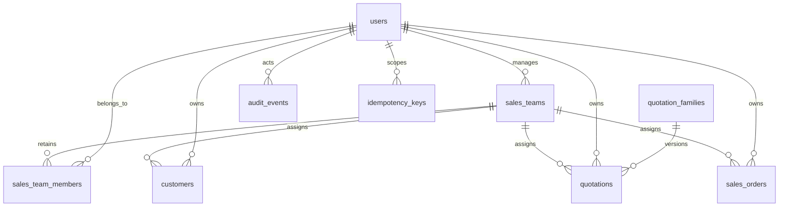

# Sales Teams backend

Six Sales Teams endpoints extend the existing Node/Express/Sequelize/MySQL application and reuse its staff, customers, quotations, orders, audit and idempotency tables. The current frontend is Next.js/React, rather than the generic Vite assumption in the brief; this delivery contains backend and [frontend integration documentation](sales-teams-ui-integration.md), without new frontend screens.

| Method | Under `/api/v1` | Purpose |
| --- | --- | --- |
| GET | `/sales-teams` | Scoped search, filters, pagination and aggregate member counts |
| GET | `/sales-teams/:id` | Profile, members, integrity warnings and bounded assignments |
| POST | `/sales-teams` | Idempotent create with existing staff |
| PATCH | `/sales-teams/:id` | Atomic profile/manager/complete active member set update |
| POST | `/sales-teams/:id/archive` | Resolve all active assignments before disabling |
| POST | `/sales-teams/:id/reactivate` | Revalidate repaired master before enabling |

Two missing dependencies were implemented separately: **GET `/users`** is a minimal eligible staff directory; **POST `/assignments/reassign`** transfers one existing customer or open document. These are not counted as team endpoints. There is no team DELETE, member CRUD, user creation/invitation, messaging, account administration, quota, salary or commission API.

Artifacts: [Team OpenAPI](sales-teams.openapi.yaml), [separate dependency OpenAPI](team-supporting-apis.openapi.yaml), [SQL reference](sales-teams.schema.sql), [Postman](postman/sales-teams.postman_collection.json), [testing and HTTP journeys](sales-teams-verification.md).

## Schema and legacy adoption

Migration006 extends `sales_teams`/`sales_team_members` additively, adds a nonyearly sequence, and indexes assignment blockers. `is_active` stays canonical; status is mapped to Active/Archived. Manager membership is a transactional invariant, not a claim about the users FK. Team/user pair primary keys remain durable. No snapshot, quantity, price, approval or commercial status is rewritten by migration or team edits.

Preflight reports active teams with invalid manager/member eligibility, excessive membership history, or active assignments whose team/owner/membership is invalid. Resolve reported records explicitly; no user, manager or first member is chosen automatically, and no data is deleted. An archived legacy team may retain invalid members for later repair. Unknown historical creator, first join, latest activation, removal and archive actor/timestamps remain **NULL**. Nullable legacy columns deliberately differ from the new-record NOT NULL conceptual contract; every supported new service write fills all applicable provenance fields. A legacy reactivation keeps unknown first join/actor null and records the actual latest activation/actor. Warnings expose provenance limitations. Existing known values are retained. No synthetic migration actor or invented historical date is required.

New team/membership writes record UTC millisecond timestamps and real authenticated actors. Removing a pair sets inactive/removal metadata; re-adding clears current removal metadata and records latest activation without replacing original join/actor. Every membership cycle has transactional audit. New archive writes full metadata; legacy unknown archive metadata is allowed by the migration's check and warned on reads. Reactivate clears only current archive metadata; audit retains known prior actions.

Codes use `TEAM-` with minimum six digits, never reset annually, never reuse archived codes. Legacy `APPAREL` remains unchanged. A one-time sequence bootstrap recognizes existing numeric TEAM codes case-insensitively under the migration advisory lock; runtime allocates under the `SALES_TEAM` row lock, never COUNT/MAX. Code and name uniqueness are independent: names may repeat; generated codes cannot.

Indexes are `(is_active,name,id)`, `(manager_id,is_active,id)`, `(created_at,id)` for teams, `(user_id,is_active,team_id)` for current scope resolution, and `(sales_team_id,owner_id,is_active)` on customers / `(sales_team_id,owner_id,status,deleted_at)` on quotations/orders. Team+owner are equality predicates for removal checks; status/deleted filters follow them. Existing team/status list indexes remain for archive/list scans. List member counts use one grouped join rather than one query per row. Literal substring `%q%` search is acceptable for this POC and is not accelerated by a B-tree; SQL values are bound and backslash/%/_ are escaped.

MySQL DDL auto-commits. Migration checks existing columns/indexes/constraints and can resume after an additive DDL interruption. Rollback refuses while team records exist. Use reviewed forward migrations for populated systems, not resets or the SQL reference file over existing tables.

## Permissions and live scope

Admin manages team masters globally. A trusted `req.user.capabilities` may explicitly contain `sales-teams:write` to grant global **team-master management** and the eligible staff directory in this single-company POC. That does not expand commercial document/customer access, grant approval rights or confer assignment permission. Other Sales/SalesManager/Viewer principals read teams only when both their claimed team scope and current active membership permit it. `manager_id` and `teamRole` express responsibility, not global permissions. A manager can manage multiple teams; a staff member can belong to multiple teams. Existing staff roles Sales, SalesManager, Admin and Viewer remain eligible as ordinary members; only active SalesManager/Admin can be manager.

Every public service entry through the existing context resolves the live active user and intersects `salesTeamIds` claims with current active memberships. There is no membership scope cache. Inactive accounts or stale role claims fail401; removed membership disappears from team/customer/quotation/order lists, details, PDFs and history on subsequent requests despite old token claims. Retained members can still read authorized history of archived teams. New memberships do not silently expand an existing narrow claim: the upstream identity adapter must refresh claims to include newly authorized team IDs. No login/token issuer was added.

All production authentication still comes from trusted middleware. Capabilities are never read from headers or body. Development selects a fixed server-side principal and is prohibited in production. Reference options now report resolved live team IDs and only the known capability names, and exclude archived/invalid teams from new-work selectors.

Document reassignment requires Admin or trusted `assignments:write` plus live permission in **both source and target** scopes. Customer reassignment requires Admin or existing `customers:write` + `customers:assign` and both scopes; it delegates to the Customer aggregate PATCH path. Same-team transfers still require assignment permission. Ordinary SalesManager status or manager title alone never grants transfer authority. Team-management capability alone cannot reassign commercial records.

Directory GET `/users?status=Active&q=...&managerEligible=true` returns only id/displayName/role/managerEligible, with pagination. Team administrators see eligible staff globally. Assignment-only principals see staff with active membership in their current scopes. `managerEligible=false` selects ordinary eligible staff. No emails, credentials or unneeded personal data are exposed.

## Membership and status semantics

POST supplies complete initial member IDs. PATCH `memberIds` is the **complete desired active set**, unlike the Customers nested change sets. Omission preserves; empty/duplicate IDs are invalid. Final manager must be included. Any actual manager or member-set change needs a trimmed reason. All final active members must be active/eligible, even on archived repairs or name-only saves. Manager change may explicitly keep or remove the old manager; their global role and old approvals remain unchanged.

Validate final state and every removal blocker before any member write. Any blocked removal rejects the whole aggregate. Parent version increments exactly once; no-op does not increment/audit, but stale no-op still conflicts. Active membership max100; durable history max500; detail is bounded at500 pairs. Inactive rows/removal metadata require `includeInactiveMembers=true`.

A user-account change outside this module can invalidate a team. Detail exposes warnings and active versus eligible counts. Fresh new customer/quotation/order creation and commercial eligibility checks validate manager, selected owner and active member state. New commercial work cannot proceed with an invalid team. To avoid trapping ownership on an inactive member, explicit transfer/repair of **existing** records can use an otherwise active target with a valid active manager/owner despite unrelated stale ordinary members; remove/repair those stale members afterward. Existing customer repairs/reactivation retain that compatibility. This exception does not permit new documents or customer creation on the invalid team.

There is no user-deactivation/role-administration API in this repository. External account administration must resolve managed-team/open ownership responsibilities before disabling staff, or perform explicit repair afterward. Guards lock/check live selected users for supported transactions; this delivery does not claim that arbitrary direct DB/user-administration writes automatically maintain all cross-record invariants.

## Active assignments and visibility

Active customers block. Every nondeleted quotation revision Draft/PendingApproval/Approved/Issued/Accepted blocks. Orders Draft/Confirmed/InProgress/PartiallyDelivered/Delivered block, including Delivered until closure or transfer. Archived customers, terminal/deleted quotations and Closed/Cancelled/deleted orders do not block. Stale date-expired Issued status remains a conservative blocker with `validityEnded` hint; archive does not expire a quotation secretly.

Removal checks only active records owned by each removed member **under this team**. Archive checks all active assignments under the team. Customer ownership stays independent of every document's operational ownership. Reassign each open document explicitly. Reassignment changes entity assignment/version/audit only; prices, quantities, snapshots, status and historical approver IDs remain untouched. Terminal documents are historical and reject transfer.

Summary counts/examples follow the existing record team policy. Admin receives company counts. Non-Admin readers, including globally authorized team administrators, receive only visible counts and up to20 authorized examples. **`canArchive` checks every assignment**, while `blockerCount` is visible-only for restricted readers; `restrictedBlockers:true` can accompany zero visible count. No hidden global total/record identity is exposed. Removal errors group visible counts and restricted flags by the requested removed member IDs. Existing filtered list APIs provide full paginated history, not the blocker examples.

Audit actions include TeamCreated/Updated/ManagerChanged/MembershipChanged/Archived/Reactivated and AssignmentReassigned. Metadata holds changed names/manager/member IDs and required reasons, without contact payload copies. Customer transfers also retain existing OwnershipChanged events through the reused aggregate path. Audit and idempotency are transactional and append-only.

## Complete locking protocol

1. Interactive service entry resolves current identity and membership without a long-lived cache. Read operations keep ordinary consistent reads; they do not acquire assignment-guard locks.
2. Team-only PATCH/archive/reactivate: team UPDATE lock → membership/selected-user validation → plain fresh READ COMMITTED assignment reads. Never acquire customer/family/order entity locks while holding team UPDATE.
3. Customer changes: customer UPDATE → source/target teams sorted by ID when transferring → membership/user checks. Customer creation: idempotency → team SHARE/member/user validation → customer sequence → new aggregate.
4. Quotation writes preserve family/quotation order; order writes preserve their order/handoff/line protocol. They take customer SHARE, then team SHARE, then membership/user validation before inserting/committing new active work. Acceptance, revision creation, conversion and confirmation participate. Existing converted Draft saves also guard current eligibility. Frozen reads/fulfilment do not require active teams for historical access.
5. Cross-team document transfer: family/quotation or order UPDATE → customer SHARE → source+target team SHARE in deterministic ID order → refresh source/target permission → active target member/user checks → update entity/version/audit. Customer transfer uses the same aggregate ownership path and sorted team order.
6. Team create: idempotency → selected users SHARE → team sequence UPDATE → new team/pairs/audit/replay. Code sequences are independent of document/customer sequences. No network effects occur inside these transactions. Bounded deadlock/timeout retries roll back/retry the complete transaction, at most twice.

A writer holding team SHARE commits its new assignment before a waiting team mutation can take UPDATE; fresh blocker reads then see it. A writer queued behind a successful archive/removal rechecks the committed team/membership and fails. Neither direction can strand a new active owner. Resolve current source+target scope again after cross-team locks, preventing stale grants while waiting. Deploy/restart **all** application writer instances with these guards before allowing team management; mixed old/new writers are not covered by the protocol.

## ER overview

`team_code_sequences` is an independent allocation guard. Shared audit entity IDs are polymorphic; manager membership is validated transactionally instead of a circular users/team FK.
